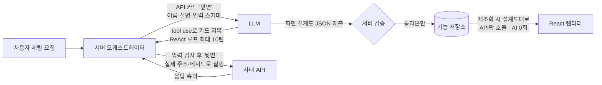

[← README로 돌아가기](../README.md)

# 🤖 AI 관련 경험

- [1. DO-AUI — 그룹웨어 AI 커스텀 대시보드 PoC](#1-do-aui--그룹웨어-ai-커스텀-대시보드-poc)
- [2. AI 기반 이중 보안 점검 체계 · PR AI 리뷰 자동화](#2-ai-기반-이중-보안-점검-체계--pr-ai-리뷰-자동화)
- [3. AI 활용 문서화 · 지식 전달](#3-ai-활용-문서화--지식-전달)
- [4. 연수 — Build with Gemini Seoul 2026](#4-연수--build-with-gemini-seoul-2026)
- [5. 학부 — 한국어 뉴스 키워드·요약 서비스](#5-학부--한국어-뉴스-키워드요약-서비스)
- [6. 학습·공유](#6-학습공유)

---

## 1. DO-AUI — 그룹웨어 AI 커스텀 대시보드 PoC

> 동기들과 진행한 AI 사이드 프로젝트 · `2026.06 ~ 2026.09` (혼자 만든 초기 프로토타입 → 5명으로 확장, 팀 개발 약 3주) · 서로 다른 4개 팀 동기 5명

**역할** — 아이디어 제안 / 초기 오케스트레이터 프로토타입 개발(Spring Boot + Claude API) / ReAct 방식 결정 / 만든 화면을 저장해 AI 없이 재실행하는 '기능 저장소' 구조 설계 / 5인 팀으로 확장하며 프로젝트 계획서·설계 가이드·발표 자료 작성

**기술** — `Spring Boot` `Claude API (tool use)` `A2UI v0.9 (Agent to UI 프로토콜)` `React 렌더러` `JSON Schema Validator` `SSE` `H2`

**문제** — 정해진 가젯만 고를 수 있는 포털 홈, 커스텀 개발 문의 2년 연속 25% 이상 증가, 고객사마다 다른 양식과 포털 밖 외부 도구

**구조**

**핵심 설계 판단**
- **AI에게는 '화면 설계'만** — 실행·검증·저장은 서버가 담당. 화면은 코드가 아닌 선언형 JSON(등록한 컴포넌트 카탈로그 47종 안에서만 조합) → 임의 코드 실행·UI 주입 위험을 구조적으로 차단
- **API 카드 앞면/뒷면 분리** — 인증 토큰은 AI로 전달하지 않고 서버 프록시가 세션 부착, 쓰기 API는 사용자 확인 후 실행
- **값이 아닌 데이터 경로를 저장** — 열 때마다 최신 데이터, 재조회 시 AI 호출 0회(비용·지연 없음)
- **LLM 교체 가능성 검토** — 망분리(설치형) 고객 대응을 위해 Ollama tool calling 규격과 비교, 수정 범위가 LLM 호출부로 한정됨을 확인

**환각 대응**
- 설계도 검증 **144개 규칙** — 카탈로그에 있는 컴포넌트인지, 경로를 채울 데이터 소스가 있는지, 실제 API 카드인지, 실측된 화면 링크인지, 쓰기 액션 확인 문구, 설계 중 본 값의 하드코딩 여부
- 위반 사유를 `tool_result(is_error)`로 되돌려 재작성 1회, 재실패 시 미저장
- API 입력값은 실행 전 `input_schema`로 검사

**결과** — 사내 API 카드 175장 + 외부 커넥터 3종(Redmine·뉴스·증권 시세) 연결, 조회뿐 아니라 회의실 예약·외부 일감 상태 변경 등 쓰기까지 시연(전자결재 현황, 회의실 현황판, 출장비 정산, 아침 브리핑 등 실제 업무 시나리오)

**팀 산출물 (발표 자료 작성 담당)** — 화면 1개 생성 원가 실측(LLM 왕복 3~4회, 입력 8.1만 + 출력 0.9만 토큰, 약 1,000원) 기반 정액 과금안, 국내외 그룹웨어 AI 기능 시장 조사

> 💡 **배운 점** — AI를 업무 시스템에 얹을 때 중요한 것은 모델 성능보다 **권한 격리·결과 검증·비용 통제를 구조로 만드는 일**. 프롬프트 규칙만으로는 지어낸 API를 막지 못했고 서버 검증이 품질을 지킴

---

## 2. AI 기반 이중 보안 점검 체계 · PR AI 리뷰 자동화

> 애드웰 → 애드콘

- AI 기반 소스 분석 + 화면 유즈케이스(블랙박스) **이중 보안 점검 체계** 설계
- 체크리스트와 단계별 프롬프트로 표준화해 타 서비스로 확산, AI 보안 점검 절차가 개발 프로세스의 정식 단계로 도입
- 도메인별 중요 보안 사항은 **PR AI 리뷰 자동화 검증 프로세스**로 도입
- 애드콘 프로젝트에서도 AI 보안 점검 체계 수립
- 활용 사례: 자동 코드 리뷰가 "메시지 테이블 전체 스캔 추가"를 지적 → 검색바 추천 쿼리 최적화로 연결([상세](work.md#⑨-조회-성능-개선-2건))

---

## 3. AI 활용 문서화 · 지식 전달
- 운영 인수인계 문서 2종을 검수 서버 화면 분석 + 폐쇄망 AI(Copilot) 코드 조사 결과를 근거로 작성, 사실 확인 기준일·브랜치를 문서에 명시
- 망 밖 AI가 볼 수 없는 폐쇄망 코드는 자급식 질문 지시문으로 만들어 폐쇄망 AI에 질의하고 회신을 반영하는 절차, 인수인계 문서 작성 절차를 재사용 가능한 AI 에이전트 스킬로 정리

---

## 4. 연수 — Build with Gemini Seoul 2026

> Google Cloud · 2026.10.14 참석 · 2026.11.13 결과보고

**참석 이유** — AI PR 리뷰를 쓰고 있으나 품질을 판단할 기준이 없어, 에이전트 개발·운영·평가를 한 흐름으로 다루는 세미나 선택

**학습 내용**
- **에이전트 통제** — A2A·MCP 표준, Human-in-the-loop → Human-on-the-loop, Identity·Registry·Gateway 통제 장치
- **하네스 핸즈온** — 에이전트 제작 → Playground 검증 → 배포 실습. 배경지식·행동 규칙·스킬·MCP 구성, Trace로 도구 호출 기록 검증
- **평가** — 코드 기반/사람/LLM-as-a-Judge 평가자, 골든 데이터셋 → 루브릭 보정(일치도 측정), 1·3·5점 루브릭, 비용·지연을 함께 보는 반복 개선
- **사내 데이터 연결** — 시맨틱 레이어 위에 MCP 연결, 난이도별 모델 라우팅

**업무 적용점**
- 에이전트 도입은 기능 추가가 아니라 권한·기록·검증을 함께 설계하는 일
- AI를 쓰는 업무마다 사람이 정한 채점 기준을 먼저 두고 변경 효과를 숫자로 확인
- 팀 개발 규칙·반복 절차를 에이전트가 읽을 수 있는 형태로 정리

---

## 5. 학부 — 한국어 뉴스 키워드·요약 서비스
> K-news-keyword-summarizer

- 한국어 뉴스 기사 크롤링 → 주제별 분류 → 키워드·내용 요약, 논문 기반 구현(LLM 등장 이전 NLP)
- 역할: 기획, 알고리즘 개발 · 기술: `Python` `Mecab`

---

## 6. 학습·공유
- AI 개발 역량을 높이고자 동기들과 AI 기반 사이드 프로젝트(DO-AUI) 진행
- 전사 동기들과 월 1회 기술 세미나

---

[← 직장 경험](work.md) · [README로 돌아가기](../README.md) · [보유 기술 →](skills.md)
